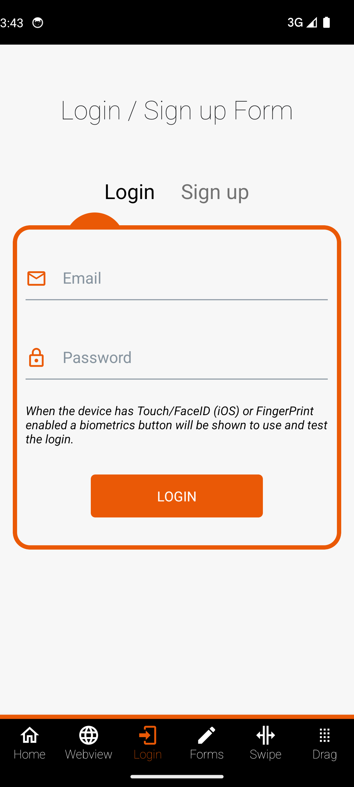
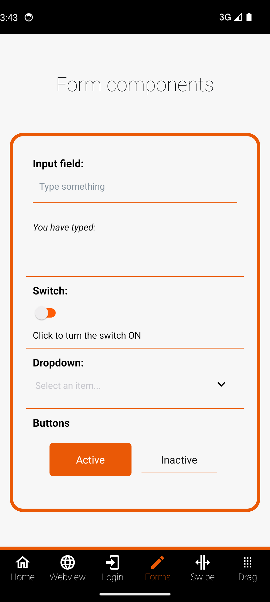
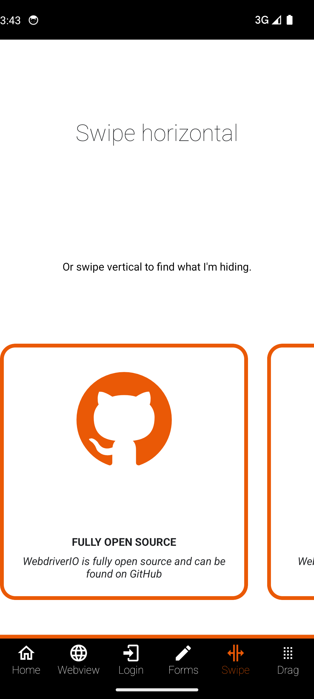
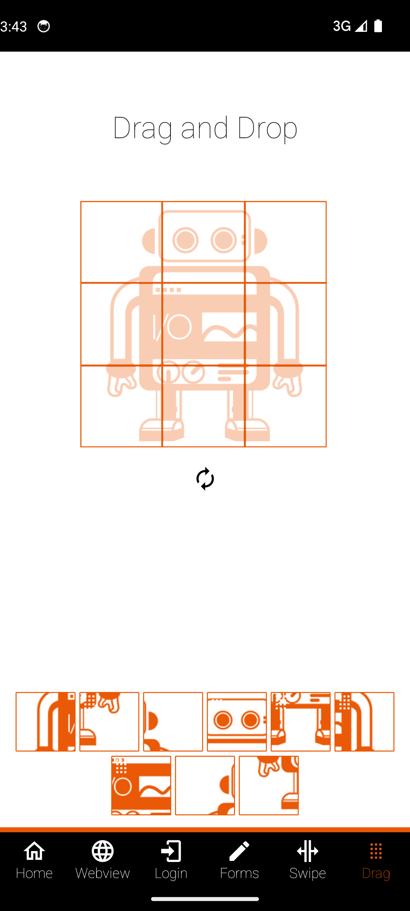

# Mobile test automation: WebdriverIO + Appium (Android)

[](https://github.com/MichaelFilbert/mobile-test-automation/actions/workflows/android.yml)

An Android UI test suite written in TypeScript with WebdriverIO v10, Appium 3 and the UiAutomator2 driver. It runs against the open-source [WebdriverIO native demo app](https://github.com/webdriverio/native-demo-app) (MIT, v1.0.8).

## Why this exists

I am a QA automation engineer. My day-to-day work is web automation with Playwright and TypeScript. Many QA job posts also ask for mobile automation, so I built this project to learn it properly and to have something concrete to show: a real emulator, real gestures, a hybrid WebView, and a CI pipeline.

## Stack

- WebdriverIO 10, Mocha, TypeScript
- Appium 3 with the UiAutomator2 driver (started by `@wdio/appium-service`, so `npm test` is the only command you need)
- Android emulator, API 34
- ESLint and `tsc --noEmit`
- GitHub Actions with `reactivecircus/android-emulator-runner`

## What is tested

| Area | Tests |
| --- | --- |
| Home | Welcome content and the six navigation tabs are shown |
| Login | Valid login shows a success alert; invalid email and short password show validation errors |
| Sign up | Mismatched passwords show an error; valid sign up shows a success alert |
| Forms | Text input echo; switch on and off; dropdown selection; active button shows an alert; inactive button does not |
| Swipe | Carousel moves to the next card and back; vertical scroll finds the hidden logo |
| Drag and drop | Completing the puzzle shows the congratulations message; renew resets it |
| WebView | Switch to the WEBVIEW context, check the page title and a DOM element, switch back to NATIVE_APP |

17 tests in total.

| Login | Forms | Swipe | Drag and drop |
| --- | --- | --- | --- |
|  |  |  |  |

## Run it locally

### macOS (Apple Silicon or Intel)

1. Install Node 20 or newer, a JDK 17 and the Android command line tools. With Homebrew, none of this needs sudo:

   ```sh
   brew install openjdk@17
   brew install --cask android-commandlinetools
   ```

2. Install the SDK pieces. The `cmdline-tools` folder has to sit inside the SDK folder, so copy it there once:

   ```sh
   source scripts/env.sh
   mkdir -p "$ANDROID_HOME/cmdline-tools"
   cp -R /opt/homebrew/share/android-commandlinetools/cmdline-tools/latest "$ANDROID_HOME/cmdline-tools/latest"
   yes | sdkmanager --sdk_root="$ANDROID_HOME" --licenses
   sdkmanager --sdk_root="$ANDROID_HOME" "platform-tools" "emulator" "platforms;android-34" "build-tools;34.0.0" \
     "system-images;android-34;google_apis;arm64-v8a"
   avdmanager create avd -n wdio_pixel_34 -d pixel_7 -k "system-images;android-34;google_apis;arm64-v8a"
   ```

   On an Intel Mac use the `x86_64` system image instead of `arm64-v8a`.

3. Install the project (this also installs the UiAutomator2 driver into `.appium/`), then download the app:

   ```sh
   npm install
   npm run app:download
   ```

4. Start the emulator, run the tests, stop the emulator:

   ```sh
   scripts/start-emulator.sh
   npm test
   scripts/stop-emulator.sh
   ```

`scripts/env.sh` only sets `JAVA_HOME`, `ANDROID_HOME` and `PATH` for the current shell. Nothing global is edited. Source it in any terminal where you run `npm test`.

### Linux and Windows

- Install JDK 17 and the Android SDK (Android Studio or the command line tools), create an AVD with API 34, and set `JAVA_HOME` and `ANDROID_HOME` yourself. `scripts/env.sh` is a bash script and mainly targets macOS and Linux.
- On Linux, use the `x86_64` system image and enable KVM.
- On Windows, run the shell scripts from Git Bash or WSL, or do the same steps by hand: start the emulator, run `npm run app:download`, then `npm test`. Windows users can also download the APK from the URL in `scripts/get-app.sh` and put it in `apps/`.

### Useful options

| Variable | Purpose |
| --- | --- |
| `APP_PATH` | Use a different APK path |
| `ANDROID_DEVICE_NAME`, `ANDROID_PLATFORM_VERSION`, `ANDROID_UDID` | Pick a device when several are connected |
| `APPIUM_AVD` | Let Appium boot this AVD itself instead of starting one first |

Run one spec: `npx wdio run wdio.conf.ts --spec test/specs/login.spec.ts`

## Reports

- The spec reporter prints results to the terminal.
- JUnit XML is written to `reports/junit/` (one file per spec) for CI.
- A screenshot of every failed test is saved to `reports/screenshots/`.
- The Appium server log is in `reports/wdio-appium.log`.

## Project structure

```
.github/workflows/android.yml   CI: lint, typecheck, emulator run, upload reports
config/env.ts                   device, app and path settings read from env vars
scripts/                        env.sh, get-app.sh, setup-appium.mjs, start/stop emulator
test/screens/                   page objects: base screen, one per app screen, alert component
test/specs/                     the test suites
test/support/hooks.ts           per-test app reset and failure screenshots
wdio.conf.ts                    WebdriverIO and Appium configuration
docs/                           screenshots of the app under test
```

## Design choices

**Page objects.** Each app screen has a class with its locators and actions. Specs read as steps and contain the assertions. `BaseScreen` holds shared helpers: waiting for the screen, swipe, and scroll. The native alert dialog is its own component because three screens use it.

**Locators.** Accessibility ids come first (`~input-email`, `~Carousel`), then resource ids (the alert dialog). Where the app gives an element no id, such as validation messages, I use a UiSelector on the text. There is no XPath.

**Waits.** All waits are explicit: `waitForDisplayed`, `waitUntil`, and the retrying `expect` matchers. `browser.pause` and `driver.pause` are banned by an ESLint rule. The only pauses are inside W3C gesture actions, where they set gesture timing.

**App state.** A root-level `beforeEach` in `test/support/hooks.ts` switches back to the native context, kills the app, starts it again and waits for the Home screen. Tests do not depend on each other.

**Gestures.** Swipes and drag and drop use W3C pointer actions, not deprecated touch actions. One thing I learned: on the Swipe screen the horizontal carousel takes any vertical drag that starts on it, so the vertical scroll starts from the strip below the carousel.

**Hybrid context switching.** The WebView test lists contexts with `getContexts()`, waits for one that starts with `WEBVIEW`, switches into it and uses normal web commands (`browser.getTitle`, `$('nav')`), then switches back to `NATIVE_APP` and checks a native element. The reset hook also switches back to native, so a failed web test cannot leave the next test in the wrong context. This test needs internet access on the emulator, because the demo app loads webdriver.io.

**Emulator choice.** Locally the config does not care which emulator runs. It talks to whatever device adb sees, so an Apple Silicon `arm64-v8a` AVD works locally and the `x86_64` image works in CI. Differences are passed through environment variables.

**Appium drivers.** Appium 3 does not discover drivers from `node_modules`. `npm install` runs `scripts/setup-appium.mjs`, which installs the UiAutomator2 driver into a project-local `.appium/` folder, and `wdio.conf.ts` sets `APPIUM_HOME` to it.

## CI

The workflow in `.github/workflows/android.yml` runs on `ubuntu-latest`, enables KVM, caches npm and the AVD, runs lint and typecheck, downloads the APK (with a size and SHA-256 check), runs the suite on an API 34 x86_64 emulator, and uploads `reports/` as an artifact. Each push runs all 17 tests on the emulator in about four minutes.

## Credits

App under test: [webdriverio/native-demo-app](https://github.com/webdriverio/native-demo-app), MIT. The APK is not stored in this repository; `scripts/get-app.sh` downloads it.

Licence: MIT, see `LICENSE`.
